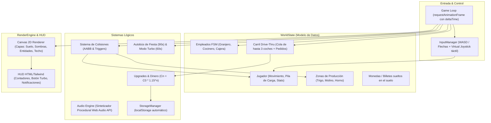

# 🍕 Plan de Desarrollo Aprobado: Pizza Drive-Thru Arcade Idle

> **Decisiones confirmadas**:
> - **Stack Tecnológico**: Web (HTML5 Canvas + JavaScript nativo + Tailwind CSS + Web Audio API). Se ejecuta sin instalaciones externas en cualquier navegador.
> - **Estilo Visual**: Gráficos procedurales y vectoriales en Canvas (formas pulidas, sombras, partículas, efectos luminosos).
> - **Plantilla de Automatización**: 3 empleados (Granjero Bot, Cocinero y Cajera).
> - **Regla actual**: No se ha escrito código de juego aún; comenzaremos cuando des el visto bueno al plan.

---

## 1. 🏗️ Arquitectura Modular del Sistema (Web)

---

## 2. 🗺️ Fases de Ejecución Paso a Paso

### 🚀 Fase 1: MVT Core Loop (Movimiento y Cadena Trigo → Harina → Horno)
- **Estructura base del proyecto**: `index.html`, `js/` (arquitectura modular), `css/`.
- **Canvas y Game Loop**: Bucle con cálculo de `deltaTime` y ajuste a tasa de refresco.
- **Control del Jugador**:
  - Movimiento en 8 direcciones con teclado (WASD/flechas) y joystick virtual en pantallas táctiles.
  - Colisiones AABB con el entorno y límites del mapa.
- **Sistema de Pila (Stack)**:
  - Dibujado apilado visualmente en la espalda del personaje.
  - Límite estricto `capacidad_carga_max` (base: 5 unidades).
- **Estaciones de Recolección y Procesado**:
  - **Campo de Trigo**: Cosecha automática por proximidad con efecto de guadaña y regeneración en 3.0s.
  - **Molino de Harina**: Zona de depósito de trigo $\rightarrow$ procesamiento de 1.5s $\rightarrow$ generación de saco de harina.
  - **Horno de Leña**: Depósito de harina $\rightarrow$ horneado de 2.0s $\rightarrow$ bandeja de pizzas listas (capacidad máx. 10).

---

### 🚗 Fase 2: Carril Drive-Thru, Pedidos y Sistema de Dinero
- **Carril Drive-Thru**:
  - Cola de hasta 3 coches simultáneos con movimiento fluido y frenado.
  - Generación aleatoria de pedidos (1 a 5 pizzas básicas) mostrados en bocadillos flotantes.
- **Ventanilla de Entrega**:
  - Transferencia progresiva de pizzas desde la espalda del jugador hacia el vehículo en cabecera.
- **Sistema de Pago y Recolección**:
  - Al completar la comanda, el coche pita y arroja fajos de billetes al suelo ($5 por pizza).
  - Recogida de billetes por proximidad magnética con animación flotante de saldo `+$X`.

---

### ⚙️ Fase 3: Upgrades, Automatización y Empleados
- **Círculos de Mejora Interactivos en Suelo**:
  - Pago progresivo mientras el jugador se mantiene en el círculo.
  - Coste acumulativo: $C_n = C_0 \times 1.15^n$.
- **Árbol de Mejoras del Jugador**:
  - Velocidad de movimiento (+20%).
  - Capacidad de carga (+3 slots por nivel).
  - Eficiencia de cosecha (más trigo por pasada).
- **IA y Automatización (3 Empleados)**:
  - 👨‍🌾 **Granjero Bot**: Patrulla el trigal, siega y lleva el trigo al molino.
  - 👨‍🍳 **Cocinero**: Transporta harina del molino al horno y supervisa la cocción.
  - 👩‍💼 **Cajera**: Toma pizzas del horno, despacha en el Drive-Thru y recoge el dinero caído.
- **Infraestructura**:
  - Nivel 2 y 3 del horno (más velocidad y capacidad).
  - Habilitación del **segundo carril Drive-Thru**.

---

### 🍅 Fase 4: Nuevas Recetas, Eventos Especiales, Audio y Persistencia
- **Cadena de Ingredientes Completa**:
  - Nivel 2: Huerto de Tomates $\rightarrow$ Pizza Margarita ($12).
  - Nivel 3: Establo de Vacas $\rightarrow$ Pizza 4 Quesos ($25).
- **Eventos Especiales**:
  - 🚌 **Autobús Turístico**: Aparición periódica (cada 90-180s) con pedido masivo (15-20 pizzas), cuenta atrás de 45s y bonificación $\times 3$.
  - 🔥 **Modo Turbo ("Fiebre de la Pizza")**: Botón de activación (cooldown 60s), velocidad $\times 2.0$ y horneado acelerado durante 10s.
- **Audio Procedural (Web Audio API)**:
  - Sin archivos MP3 externos: sonidos sintetizados para cosecha (swish), depósito, horneado, bocina de coche y caja registradora.
- **Persistencia**:
  - Guardado y carga transparente en `localStorage` (saldo, niveles de mejoras, recetas y empleados).

